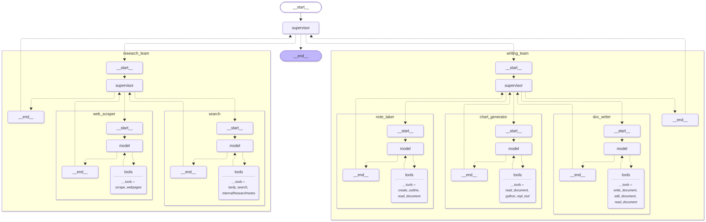

# Hierarchical Agent with RAG

A hierarchical multi-agent system built with LangGraph and LangChain. A top-level supervisor delegates tasks to two teams, and each team has its own supervisor managing tool-using worker agents.



## Architecture

- **Top-level supervisor**: routes the request to a team and ends the run when the task is done.
- **research_team**
  - `web_scraper`: scrapes web pages (`scrape_webpages`)
  - `search`: web search and RAG over internal notes (`tavily_search`, `InternalResearchNotes`)
- **writing_team**
  - `note_taker`: creates outlines (`create_outline`, `read_document`)
  - `chart_generator`: builds charts (`read_document`, `python_repl_tool`)
  - `doc_writer`: writes and edits documents (`write_document`, `edit_document`, `read_document`)

## Tech Stack

LangGraph, LangChain, Groq, Tavily, Hugging Face embeddings, FAISS, uv, Python 3.14

## Setup

1. Create a virtual environment and install dependencies with [uv](https://docs.astral.sh/uv/):

```bash
uv venv --python 3.14
source .venv/bin/activate   # Windows: .venv\Scripts\activate
uv pip install -r requirements.txt
```

2. Create a `.env` file:

```env
GROQ_API_KEY=your_groq_api_key
TAVILY_API_KEY=your_tavily_api_key
```

3. Run:

```bash
uv run python main.py
```

## Requirements

```text
langchain
langgraph
langchain-community
langchain-core
langchain-groq
langgraph-supervisor
langchain-tavily
langchain-huggingface
faiss-cpu
sentence-transformers
python-dotenv
langchain-experimental
```

## Author

Pawan: [GitHub](https://github.com/Pawankumarsani) · [LinkedIn](https://linkedin.com/in/pawan-sani-224a2242b) · [X](https://x.com/PawanSani11)